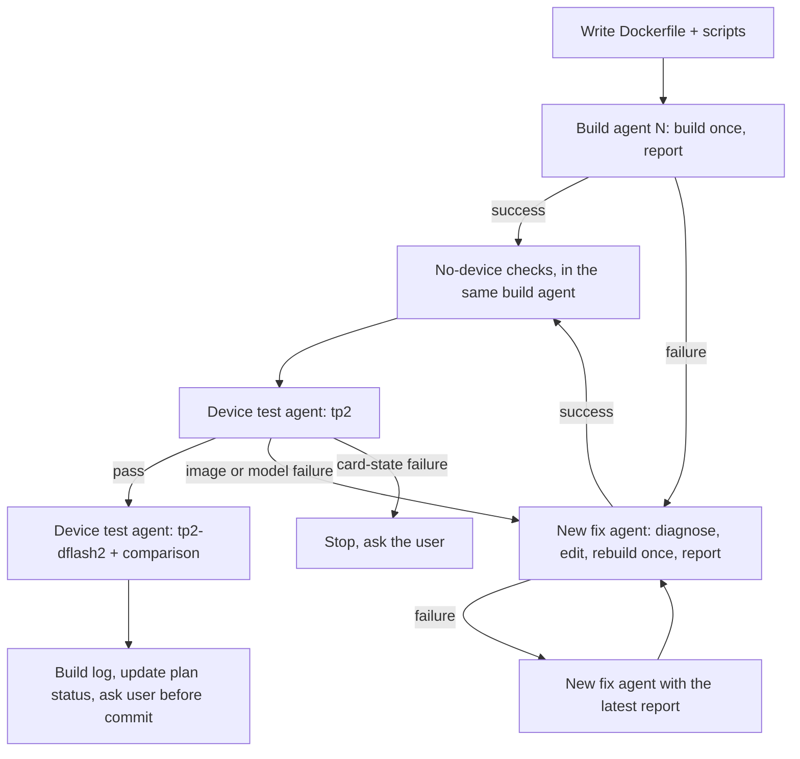

# Plan: ARM64 image for Qwen3.8-27B on 2x P150 (TP=2, BFP8/BFP4, DFlash2 speculative decoding)

Status: **built, awaiting device tests** (image `tt-model/qwen3.8-27b-p150x2:arm64` passes all no-device
checks; device tests blocked on tt-studio holding `/dev/tenstorrent` + port 8000). Written 2026-09-29 for a
fresh agent to execute. Read all of it before starting. Progress: section 8 and
[`arm64-qwen3.8-27b-p150x2-build-log.md`](arm64-qwen3.8-27b-p150x2-build-log.md).

Goal: a native **aarch64** Docker image that serves `Qwen/Qwen3.8-27B` with vLLM on this host's two
Blackhole P150 cards. It should include the profile with **DFlash2 speculative decoding**
(`tp2-dflash2`) and use the model's validated BFP8/BFP4 precision mix. It rebuilds the existing,
validated **amd64** package `changh95/qwen3.8-27b-p150x2` (image
`tt-model/qwen3.8-27b-p150x2:85f009466e2e`, which exists locally but can't run here:
`exec format error`).

Related, already-done work on this host (read for patterns, don't redo):

- `docs/arm64-vllm-tt-metal-image-plan.md` + `docs/arm64-vllm-tt-metal-build-log.md`: Llama-3.1-8B
  arm64 image, built and validated on this host (1 card and TP=2). Commit `046534ac`.
- `vllm-tt-metal/vllm.tt-metal.src.dev.arm64.Dockerfile`: its Dockerfile. The same aarch64 fixes
  apply here.
- `chathaway-tt-metal/dockerfile/ARM64_RELEASE_BUILD_PLAN.md`: how the base image
  `tt-metalium-release:local` was built.

---

## 0. Rules for the executing agent

1. **Never run `docker build` yourself. Always delegate it.** Each build attempt goes to a *new*
   subagent (`spawn_agent`). If it fails, give the failure report to a *new* subagent that
   diagnoses, fixes, rebuilds once and reports. Repeat. See section 5 for the loop and prompt
   templates.
2. Device tests (anything using `/dev/tenstorrent`) also go to subagents, because they are long
   running. You may run short read-only commands yourself (inspecting files, `docker images`,
   `docker ps`, `curl` for downloads/metadata).
3. Both cards are available for this work (the user confirmed). `ttserve` must stay stopped;
   never start it. Check `docker ps` before every device test. If anything else holds
   `/dev/tenstorrent` or port 8000, stop and ask the user.
4. **Never run `tt-smi -r` (reset) and never reboot.** If a device fails to initialize
   (`failed to initialize FW`, `Timeout ... waiting for physical cores`), stop and ask the user
   (last time a hard reboot was needed). Stop servers with `docker stop` (SIGTERM, clean mesh
   close). Never use `docker kill` or `docker rm -f` on a running TT server: SIGKILL leaves the
   cards needing a reset.
5. Don't touch unrelated user changes. The working tree has a staged `.gitmodules` change, a staged
   `chathaway-tt-metal` entry, and untracked `demo.py`, `sample.py`, `run_falcon_generation.py`.
   When committing, commit **only** your files with an explicit pathspec
   (`git commit -- <paths>`). Commit only at the end, and only after the user has seen the results.
6. The user approved: using both cards, the validated precision mix (no all-BFP4 variant), and
   downloading the 3.85 GB DFlash2 drafter into `/mnt/md0/huggingface`.
7. `/tmp` is wiped on reboot. Keep build logs in `/tmp` if you like, but copy everything that
   matters (commands, timings, key errors, results) into the build log doc as you go.

---

## 1. Findings (already verified)

### Host

| | |
|---|---|
| Host | Ubuntu 24.04 **aarch64**, 80 cores, 125 GB RAM, motherboard `MP32-AR0-JG` (tt-metal warns "Unknown motherboard" and falls back to bus IDs; harmless) |
| Devices | 2x Blackhole P150 at `/dev/tenstorrent/{0,1}`, ethernet-linked; 1 GB hugepages at `/dev/hugepages-1G`; FW 19.13.2, KMD 2.10.0 |
| Docker | 29.7.2, buildx 0.36.1. The user is in the `docker` group; `sudo` needs a password (unavailable) |
| Disk | `/` about 180 GB free; `/mnt/md0` 553 GB free |

### The x86 package being ported

The definition lives in tt-metal at `models/demos/blackhole/qwen36/tt-model.yaml`. A copy is at
`vllm-tt-metal/qwen3.8-27b-p150x2.arm64/reference-x86/tt-model.yaml`, byte-identical to the
commit below. **Read its header comments; they explain every setting.**

| Piece | Pin | Notes |
|---|---|---|
| tt-metal | `tenstorrent/tt-metal@aa20afaf172ac35370b8d112edc0f771ee6d2571` (`v0.79.0-dev20260903-120-gaa20afaf17`; ttnn reports `0.65.2.dev9815`) | Public on GitHub. Has `models/demos/blackhole/qwen36/` incl. `vllm_bundle/`, `mesh/p150_x2_2link_mesh_graph_descriptor.textproto`, `tt/qwen36_vllm_dflash.py`, `tt/dflash2*.py`. Has `cmake/aarch64-linux-clang-20-libstdcpp-toolchain.cmake`; SFPI 7.73.0 with aarch64 hashes |
| TT vLLM plugin | `https://github.com/changh95/vllm-tt-plugin@ab5f7f3d795ee519b5d96f41f31cc1e0f635d6a7` | Public. Install recipe: `docs/install-vllm-tt.sh`, `docs/vllm-overrides.txt` in that repo |
| vLLM | `0.26.0`, built with `VLLM_TARGET_DEVICE=empty` from the sdist (`--no-binary vllm`); reports `0.26.0+empty` | **Don't** install the PyPI `vllm` wheel (that's the CUDA build) |
| Python | 3.12 (uv-managed CPython, relocatable venv at `/opt/tt-venv`) | See `reference-x86/pyvenv.cfg` |
| Key packages | torch `2.11.0+cpu`, torchvision `0.26.0+cpu`, transformers `5.17.0`, numpy `1.26.4`, tokenizers `0.23.2`, safetensors `0.8.0`, triton `3.8.0`, flashinfer_python `0.6.14`, torchcodec `0.16.0+cpu` | Full list (216 dists): `reference-x86/x86-venv-packages.txt` (`name-version` per line) |
| Qwen weights | `Qwen/Qwen3.8-27B@1d4bf0f2ff6012fd82039f2fa52739d0dd7c60c0` | **Already on disk**, 81 GB at `/mnt/md0/huggingface/hub/models--Qwen--Qwen3.8-27B` (standard HF layout, real files in `blobs/`). `~/.cache/huggingface` only has a 28 KB stub; don't use it |
| DFlash2 drafter | `incoai/Qwen3.8-27B-DFlash2@dedf8df68adfb1afeaf7b7480c0a0243108177b4` | Not gated, Apache-2.0, `model.safetensors` 3,848,817,896 bytes. **Not downloaded yet** (section 4) |

### Profiles (from `tt-model.yaml`)

| Profile | What | Users | Notes |
|---|---|---|---|
| `tp2` (default) | Plain TP=2 over both chips | 32 | 64K ctx, 622,592-token BFP8 KV pool, host sampling |
| `p1d1` | Prefill chip + decode chip over the fabric (MPI supervisor) | 8 | Optional here; needs `mpirun`, `TT_SERVE_LAUNCHER=pd_container` |
| `tp2-dflash2` | TP=2 + lossless DFlash2 speculation | 1 to 4 | Greedy output; reported 1.5x/user at <=2k ISL, 3.7x on code, fading to 1.07x at 32k ISL; `sample_on_device_mode: decode_only`; `--no-async-scheduling` |

### Precision (fixed in code; no knob; keep as is)

- Attention/GDN weights: `bfloat8_b` (`tt/model_config.py`: `self.weight_dtype = ttnn.bfloat8_b`).
- MLP gate/up: `bfloat4_b`; MLP down: `bfloat8_b` (`tt/mlp.py`).
- Paged KV cache: `bfloat8_b` via `QWEN_SDPA_BF8=1` (in every profile's env). The pools don't fit
  at bf16.

### Image layout the scripts assume (from the x86 image; mirror it)

| Path / setting | Value |
|---|---|
| tt-metal tree | `/opt/tt-metal` (`TT_METAL_HOME`, `TT_METAL_RUNTIME_ROOT`, `PYTHONPATH`) with `build/`, `build_Release/`, `runtime/`, `tt_metal/`, `ttnn/`, `tools/`, `models/` (at least the allowlist in `tt-model.yaml` `source.code`) |
| venv | `/opt/tt-venv` (`VENV`, `VIRTUAL_ENV`, first on `PATH`) |
| OpenMPI | `/opt/openmpi-v5.0.7-ulfm` (the base image has it at this exact path) |
| SFPI | `/opt/tenstorrent` (x86 image copied it; not needed if tt-metal downloads SFPI at build time into its tree) |
| `LD_LIBRARY_PATH` | `/opt/tt-metal/build/lib:/opt/openmpi-v5.0.7-ulfm/lib` |
| `EXTRA_MODELS_DIR` | `/opt/tt-metal/models/demos/blackhole/qwen36/vllm_bundle` |
| other env | `TT_VLLM_BUILTIN_MODELS=0`, `TT_MODEL_KIND=vllm-plugin`, `HF_HOME=/hf`, `TT_METAL_CACHE=/cache` |
| user | `tt`, `HOME=/home/tt`, `WORKDIR /home/tt/work` (must be writable) |
| entrypoint | `reference-x86/entrypoint.sh` (arch-neutral; reuse as is) |
| default CMD | `reference-x86/serve-default.sh` (= `tp2` profile; arch-neutral) |
| image self-check | `reference-x86/verify.sh` (run at build time in the x86 image) |

Base image `tt-metalium-release:local` (arm64, `bd99e0346dfe`, Ubuntu 22.04, clang-20/lld-20,
CMake 4.2.3, ninja, uv 0.9.26 in `/usr/local/bin`, OpenMPI ULFM at `/opt/openmpi-v5.0.7-ulfm`,
Python 3.10 system). Its env activates `/opt/venv` (its own ttnn): `PATH=/opt/venv/bin:...`,
`VIRTUAL_ENV=/opt/venv`, `PYTHON_ENV_DIR=/opt/venv`. Reset these (lesson from the Llama build).

---

## 2. Deliverables

```
vllm-tt-metal/qwen3.8-27b-p150x2.arm64/
  Dockerfile                    # multi-stage, native arm64
  entrypoint.sh                 # copy of reference-x86/entrypoint.sh
  serve-tp2.sh                  # = reference-x86/serve-default.sh (default CMD)
  serve-tp2-dflash2.sh          # generated from tt-model.yaml profile tp2-dflash2 (section 3.3)
  serve-p1d1.sh                 # optional, same way
  verify.sh                     # adapted from reference-x86/verify.sh
  reference-x86/                # already there: files taken from the x86 image, don't edit
docs/arm64-qwen3.8-27b-p150x2-plan.md       # this file: update Status as you go
docs/arm64-qwen3.8-27b-p150x2-build-log.md  # new: same format as docs/arm64-vllm-tt-metal-build-log.md
```

Image tag: `tt-model/qwen3.8-27b-p150x2:arm64` (also tag
`tt-model/qwen3.8-27b-p150x2:arm64-aa20afaf-ab5f7f3`). Don't overwrite the amd64
`:85f009466e2e` tag.

---

## 3. Dockerfile design

Build context: `vllm-tt-metal/qwen3.8-27b-p150x2.arm64/`. Everything else is cloned from GitHub
at pinned SHAs.

### 3.1 Builder stage (`FROM tt-metalium-release:local AS builder`)

1. `ENV PATH=/opt/openmpi-v5.0.7-ulfm/bin:/usr/local/sbin:/usr/local/bin:/usr/sbin:/usr/bin:/sbin:/bin VIRTUAL_ENV= PYTHON_ENV_DIR=`
2. apt: `git ca-certificates curl build-essential pkg-config` (+ whatever the build proves is
   missing).
3. Clone tt-metal to `/opt/tt-metal` at `aa20afaf...`, `git submodule update --init --recursive`.
4. Build:
   `CMAKE_BUILD_PARALLEL_LEVEL=48 ./build_metal.sh --toolchain-path cmake/aarch64-linux-clang-20-libstdcpp-toolchain.cmake`
   (its default is the x86_64 toolchain, which adds `-march=x86-64-v3` and fails on aarch64). Add
   `--build-type Release` if needed, and whatever flag builds the Python bindings/distributed.
   Check `./build_metal.sh --help` at that commit. The x86 image has both `build/` and
   `build_Release/` (one is a symlink or copy of the other), plus `runtime/`.
5. venv: `CC=clang-20 CXX=clang++-20 ./create_venv.sh --python-version 3.12 --env-dir /opt/tt-venv --force`
   (installs tt-metal requirements-dev + `pip install -e .` for ttnn). It creates a relocatable
   venv with uv-managed CPython. Make sure the interpreter it points to is carried into the
   runtime stage (the x86 image copied `/usr/local/share/uv`; so set `UV_PYTHON_INSTALL_DIR=/usr/local/share/uv/python`
   or copy wherever uv put it). Retry loop as in the Llama Dockerfile (PyTorch CDN flakes).
6. vLLM + plugin, following the plugin's `docs/install-vllm-tt.sh` inside `/opt/tt-venv`:
   ```sh
   git clone https://github.com/changh95/vllm-tt-plugin /opt/vllm-tt-plugin && cd /opt/vllm-tt-plugin && git checkout ab5f7f3d795ee519b5d96f41f31cc1e0f635d6a7
   curl -fsSL https://raw.githubusercontent.com/vllm-project/vllm/v0.26.0/requirements/common.txt -o /tmp/common.txt
   uv pip install --override docs/vllm-overrides.txt -r /tmp/common.txt
   uv pip install --no-deps --index-url https://download.pytorch.org/whl/cpu torchvision==0.26.0
   VLLM_TARGET_DEVICE=empty uv pip install --no-deps --no-binary vllm vllm==0.26.0
   uv pip install -e .      # or a non-editable install; the runtime stage must still see it
   ```
   **Version alignment:** the validated x86 venv is the ground truth
   (`reference-x86/x86-venv-packages.txt`). Note that `vllm-overrides.txt` caps
   `transformers<5.15.0`, but the x86 image shipped **transformers 5.17.0**, so the package build
   used a lock file (`requirements.lock`, not in the image). Turn the x86 list into a constraints
   file (`name==version`, drop local tags like `+cpu`/`+empty`, drop `ttnn`, `vllm`, `vllm_tt_plugin`,
   drop packages without aarch64 wheels) and pass it with `-c`/`--override` so versions match.
   At minimum pin torch 2.11.0 (+cpu, from the PyTorch CPU index), transformers 5.17.0,
   numpy 1.26.4. `verify.sh` asserts torch is `2.11.0+cpu` and that `vllm` is not imported from the
   tt-metal tree.
7. Optional helpers from the x86 venv that may lack aarch64 wheels: `flashinfer_python`,
   `torchcodec`, `triton`. The text-only TP path shouldn't need them (vision is skipped with
   `QWEN36_SKIP_VISION=1`). If one blocks the install, drop it from the constraints and note it in
   the build log. Don't source-build unless an import actually needs it.
8. Trim: `rm -rf /opt/tt-metal/.git`, build intermediates the runtime doesn't need (keep
   `build/lib`, `build_Release/lib`, `runtime/`, the JIT kernel sources in `tt_metal/`, `ttnn/`).
   Measure first; correctness before size.

### 3.2 Runtime stage (`FROM tt-metalium-release:local`)

- Same `PATH`/`VIRTUAL_ENV` reset, then the env table in section 1 (`PATH=/opt/tt-venv/bin:...`).
- Runtime apt packages if something needs them (for example `libgl1`, `libsndfile1`; add only what
  imports need).
- User: `useradd -m -u 1000 -s /bin/bash tt`. UID 1000 = the host user `charles`, so bind mounts
  work with `--user 1000:1000`.
- `COPY --from=builder` `/opt/tt-metal`, `/opt/tt-venv`, `/opt/vllm-tt-plugin` (if editable), the uv
  Python install dir, and SFPI if it lives outside the tree. Fix ownership to `tt`.
- `COPY` `entrypoint.sh` to `/usr/local/bin/entrypoint.sh`, and `serve-*.sh` to `/usr/local/bin/`
  (`--chmod=0755`).
- `COPY verify.sh` and run it at build time (as the x86 image did). Adapt it: drop checks that need
  things you intentionally left out, and say so in the build log.
- `USER tt`, `WORKDIR /home/tt/work`, `ENTRYPOINT ["/usr/local/bin/entrypoint.sh"]`,
  `CMD ["/usr/local/bin/serve-tp2.sh"]`.
- Labels like the x86 image (`org.tenstorrent.tt-model=qwen3.8-27b-p150x2`, `...profiles=tp2,p1d1,tp2-dflash2`,
  `...tt-metal=aa20afaf...`, `...plugin=ab5f7f3...`) plus `org.opencontainers.image.architecture=arm64`.

### 3.3 `serve-tp2-dflash2.sh`

Same shape as `reference-x86/serve-default.sh`. The env is `serve.env` merged with the
`tp2-dflash2` profile's `env`, and the args come from the profile. The expected result (check it
against `tt-model.yaml`):

```bash
export ARCH_NAME=blackhole HF_HUB_OFFLINE=1 HF_MODEL=Qwen/Qwen3.8-27B MESH_DEVICE=P150x2
export TT_QWEN35_TEXT_VER=qwen36_blackhole QWEN36_SKIP_VISION=1 QWEN_SDPA_BF8=1
export VLLM_RPC_TIMEOUT=900000 VLLM_CONFIGURE_LOGGING=1 TORCHDYNAMO_DISABLE=1
export TT_MESH_GRAPH_DESC_PATH=/opt/tt-metal/models/demos/blackhole/qwen36/mesh/p150_x2_2link_mesh_graph_descriptor.textproto
export QWEN36_DRAFTER=dflash2 QWEN36_DFLASH_TP=1 QWEN36_GDN_SPEC_FUSED=1
export QWEN36_DFLASH_BLOCK=8 QWEN36_DFLASH_FOLD_SEED=1 QWEN36_DFLASH_SERVE_BLOCK=32
export QWEN36_PREFILL_BUCKET_TRACE=0
export DFLASH_WEIGHTS=incoai/Qwen3.8-27B-DFlash2@dedf8df68adfb1afeaf7b7480c0a0243108177b4
export QWEN36_MAX_TOKENS_ALL_USERS=262144
export TT_CACHE_PATH=/cache/tensors-tp2
# NO TT_MODEL_CLASS_OVERRIDES: the bundle's main_class (Qwen36DFlashForCausalLM) must win.
# NO QWEN36_MTP=0 here (the tp2 profile sets it; dflash2 doesn't).
exec vllm serve Qwen/Qwen3.8-27B --max-model-len 65536 --max-num-seqs 4 --block-size 64 \
  --additional-config '{"tt": {"l1_small_size": 24576, "fabric_config": "FABRIC_1D", "trace_region_size": 1073741824, "sample_on_device_mode": "decode_only"}}' \
  --enable-auto-tool-choice --tool-call-parser qwen3_coder --reasoning_parser qwen3 \
  --max-num-batched-tokens 65536 --no-async-scheduling --port 8000
```

Keep the `/dev/tenstorrent` usage-message guard from `serve-default.sh`.

---

## 4. Host preparation (you may do these directly; they aren't builds)

`/mnt/md0/huggingface` and `/mnt/md0/tt-metal-cache` are `root:root 755` and `sudo` isn't
available, so write through a root container:

```sh
# Drafter (3.85 GB) into the shared HF cache, pinned revision
docker run --rm -v /mnt/md0/huggingface:/hf -e HF_HOME=/hf python:3.12-slim sh -c \
  'pip install -q "huggingface_hub[cli]" && hf download incoai/Qwen3.8-27B-DFlash2 --revision dedf8df68adfb1afeaf7b7480c0a0243108177b4'
# (older hub versions: huggingface-cli download ...). Then verify:
ls -la /mnt/md0/huggingface/hub/models--incoai--Qwen3.8-27B-DFlash2/snapshots/dedf8df68adfb1afeaf7b7480c0a0243108177b4/

# Writable cache dir for the container (JIT kernels + converted tensors), owned by UID 1000
docker run --rm -v /mnt/md0:/m alpine sh -c 'mkdir -p /m/tt-model-cache/qwen3.8-27b-p150x2 && chown -R 1000:1000 /m/tt-model-cache'
```

The HF cache is mounted read-only into the server, so the drafter must be complete before the
first `tp2-dflash2` start. Check how `DFLASH_WEIGHTS` is resolved (`grep -rn DFLASH_WEIGHTS` in
`models/demos/blackhole/qwen36/tt/`) to confirm it reads `$HF_HOME/hub` offline.

---

## 5. Build / test loop (how to delegate)



Loop rules:

- Number attempts: build logs are `/tmp/qwen-arm64-build-<N>.log`, run logs `/tmp/qwen-arm64-run-<profile>-<N>.log`.
- After every agent report: add a short entry to the build log doc (attempt N, duration, result, root
  cause, fix), then decide the next step.
- Fix agents may edit **only** files under `vllm-tt-metal/qwen3.8-27b-p150x2.arm64/` (not
  `reference-x86/`). If a fix would need a source change in tt-metal or the plugin, the agent must
  stop and report instead. You then decide (a patch step in the Dockerfile is acceptable if small,
  and must be documented).
- If the same root cause survives 2 fix attempts, stop and ask the user.
- Subagents can't use `cd` outside project roots. They must pass absolute paths (the build context
  is inside the repo, so `cd=/home/charles/p3/tt-inference-server` works).
- Always tell subagents: use `timeout_ms` and `tail_lines`, never pipe to `head`/`tail`, and never
  block forever (servers run with `-d` and are polled).

### 5.1 Build agent prompt (template)

> You are running a Docker build on a native aarch64 host (80 cores, 125 GB RAM). Your ONLY job is
> to run the build once and report. Don't edit files, don't fix, don't retry with changes.
>
> Context: arm64 image for Qwen3.8-27B on Tenstorrent P150x2. Dockerfile
> `vllm-tt-metal/qwen3.8-27b-p150x2.arm64/Dockerfile` in `/home/charles/p3/tt-inference-server`,
> base `tt-metalium-release:local`. It clones and builds tt-metal `aa20afaf` with clang-20 (the
> longest part), creates a Python 3.12 venv, and installs vLLM 0.26.0 (`VLLM_TARGET_DEVICE=empty`)
> and `changh95/vllm-tt-plugin@ab5f7f3`.
>
> Run `date -u`, then (terminal, cd=/home/charles/p3/tt-inference-server, timeout_ms 7200000,
> tail_lines 20):
> `docker build --progress=plain -f vllm-tt-metal/qwen3.8-27b-p150x2.arm64/Dockerfile -t tt-model/qwen3.8-27b-p150x2:arm64 vllm-tt-metal/qwen3.8-27b-p150x2.arm64 > /tmp/qwen-arm64-build-<N>.log 2>&1; echo EXIT=$?`
> then `date -u` again.
>
> If EXIT=0, run these no-device checks and include their output:
> 1. `docker image inspect tt-model/qwen3.8-27b-p150x2:arm64 --format '{{.Architecture}} {{.Size}} {{json .Config.Entrypoint}} {{json .Config.Cmd}}'`
> 2. `docker run --rm --entrypoint bash tt-model/qwen3.8-27b-p150x2:arm64 -c 'python --version; python -c "import ttnn, torch, transformers, vllm, vllm_tt_plugin; print(torch.__version__, transformers.__version__, vllm.__version__)"; python -c "import os; os.environ[\"QWEN36_DRAFTER\"]=\"dflash2\"; from models.demos.blackhole.qwen36.tt.qwen36_vllm_dflash import Qwen36DFlashForCausalLM; from models.demos.blackhole.qwen36.tt.qwen36_vllm import Qwen36ForCausalLM; print(\"model classes OK\")"; bash /usr/local/bin/serve-tp2.sh; echo rc=$?'`
>    (the serve script should print its usage message and exit 1 without devices).
> 3. `docker run --rm --entrypoint bash tt-model/qwen3.8-27b-p150x2:arm64 -c 'id; ls -la /opt/tt-metal/build/lib | head; ls /opt/tt-metal/models/demos/blackhole/qwen36/mesh /opt/tt-metal/models/demos/blackhole/qwen36/vllm_bundle'`
>
> If EXIT!=0: investigate the log read-only (`grep -n -E 'error|Error|ERROR|failed|FAILED' ... | tail -60`,
> the last 150 lines, and context around the FIRST real error). Report: which Dockerfile step
> failed, the first root-cause error verbatim (up to ~60 lines), how long it ran, and a
> one-paragraph diagnosis. No fixes.
>
> Final message: SUCCESS/FAILURE, start/end/duration, log path, check outputs or failure details.

### 5.2 Fix agent prompt (template)

> You are fixing a failed Docker build on a native aarch64 host. Build context:
> `/home/charles/p3/tt-inference-server/vllm-tt-metal/qwen3.8-27b-p150x2.arm64/`. Read
> `docs/arm64-qwen3.8-27b-p150x2-plan.md` (sections 1 and 3) for background. You may edit ONLY files
> in that directory, excluding `reference-x86/`. Don't change tt-metal/plugin/vLLM pins. If the
> fix needs a source change in tt-metal or the plugin, stop and report instead.
>
> Previous attempt report:
> <paste the build agent's failure report verbatim>
>
> Steps: 1) confirm the root cause from `/tmp/qwen-arm64-build-<N>.log`. 2) make the smallest fix
> (a comment marked `arm64:` explaining it). 3) rebuild once with the same command, logging to
> `/tmp/qwen-arm64-build-<N+1>.log` (timeout_ms 7200000, tail_lines 20). 4) if it passes, run the
> 3 no-device checks from the build template. Report: root cause, the diff you made, the build
> result (with failure details in the same format if it fails again), and timings.

### 5.3 Device test agent prompt (template)

> You test a freshly built image on a native aarch64 host with 2x Tenstorrent Blackhole P150
> (`/dev/tenstorrent/{0,1}`, ethernet-linked), hugepages at `/dev/hugepages-1G`. Run tests and
> report. Don't edit repo files, don't rebuild, don't fix. NEVER run `tt-smi -r`, never reboot,
> never `docker kill`/`rm -f` a running server (use `docker stop`, which lets it close the mesh).
> Never start the `ttserve` container.
>
> Preflight: `docker ps` (nothing may use /dev/tenstorrent or port 8000; if something does,
> stop and report), `ls -la /dev/tenstorrent /dev/hugepages-1G`,
> `ls /mnt/md0/huggingface/hub/models--Qwen--Qwen3.8-27B/snapshots/`, drafter snapshot present
> (dflash2 test only).
>
> Start (profile = `tp2` or `tp2-dflash2`):
> ```
> docker run -d --name qwen-arm64-<profile> --device /dev/tenstorrent --ipc host \
>   --mount type=bind,src=/dev/hugepages-1G,dst=/dev/hugepages-1G \
>   --volume /mnt/md0/huggingface:/hf:ro \
>   --volume /mnt/md0/tt-model-cache/qwen3.8-27b-p150x2:/cache \
>   --user 1000:1000 --publish 127.0.0.1:8000:8000 \
>   tt-model/qwen3.8-27b-p150x2:arm64 /usr/local/bin/serve-<profile>.sh
> ```
> Poll every 60 s (batch up to 10 polls per call, timeout_ms up to 900000): container status,
> `curl -s -o /dev/null -w '%{http_code}' localhost:8000/v1/models`, `docker logs --tail 5`.
> The first start compiles kernels and converts weights; allow up to 90 min. If the container
> exits, or logs show a device init failure, stop polling and report.
>
> Once ready, run (record wall time with `time`):
> 1. `GET /v1/models`
> 2. Chat, `temperature: 0`, `max_tokens: 256`: "What is the capital of France? Answer briefly."
>    (record the `reasoning_content` and `content` split)
> 3. Tool call with a `get_weather(city)` tool, `tool_choice: auto`, prompt "What is the weather in
>    Paris right now?"; check `tool_calls` has get_weather/Paris
> 4. Decode speed, single user, `temperature: 0`, `ignore_eos: true`, `max_tokens: 512`, short
>    prompt; tokens/s = completion_tokens / wall time. Repeat 2x after warmup.
> 5. Code prompt, `temperature: 0`, `max_tokens: 512`: "Write a Python function that parses an ISO
>    8601 date string without using datetime.fromisoformat, with tests." Record tokens/s and save
>    the full `content` to `/tmp/qwen-arm64-<profile>-code.txt`.
> 6. Same as 5, but save the text of prompt 2 to `/tmp/qwen-arm64-<profile>-france.txt`.
> 7. (tp2 only) 4 concurrent requests like 4 (use `&` + `wait`), aggregate tokens/s.
> 8. (tp2-dflash2 only) extract spec-decode stats from the logs or `/metrics`
>    (`grep -i -E 'accept|spec|draft'`).
>
> Save logs: `docker logs qwen-arm64-<profile> > /tmp/qwen-arm64-run-<profile>-<N>.log 2>&1`.
> Extract the startup phases with timestamps, the time to ready, and deduplicated
> WARNING/ERROR/Traceback lines (at most 40). Then `docker stop qwen-arm64-<profile>` and
> `docker rm qwen-arm64-<profile>`.
>
> Report: preflight, time to ready and phases, each request's result, tokens/s numbers,
> warnings, log paths. On failure: the stage, the first root-cause error with ~40 lines of
> context, and whether it looks like a card-state problem (device init/timeouts) or an
> image/model problem (imports, missing libs, model code, compile errors).

---

## 6. Test sequence and acceptance

1. **Build** passes; no-device checks show arm64, Python 3.12, torch `2.11.0+cpu`, vLLM `0.26.0+empty`,
   both model classes import, and the serve script's usage guard works.
2. **`tp2`** (baseline) on device: ready, chat answers correctly, the tool call parses, and there are
   no errors. Record single-user and 4-user tokens/s and time to ready (cold, then warm on a second
   start if time allows).
3. **`tp2-dflash2`** on device: ready, same requests. Compare with `tp2`:
   - **Lossless check:** with `temperature: 0`, the `tp2-dflash2` outputs for prompts 5 and 6 should
     match `tp2`'s (`diff` the saved files). Small divergence far into a long output can come from
     numerics in the verify path (`tt-model.yaml` claims "lossless-class identity"). Report the first
     divergence position, if any.
   - **Speed-up:** single-user tokens/s vs `tp2` on the short prompt and on the code prompt. The
     reference is 1.5x at <=2k ISL and 3.7x on code. Report the ratios, and the acceptance stats if
     available.
4. Optional: `p1d1` (needs `mpirun`, the fabric between cards; `TT_PD_CONNS=2` means 2 trained
   ethernet links. If this host's cards have one cable, check what the logs say).
5. **Done when:** 1 to 3 pass, the build log is complete, and the plan status is updated. Then show the
   user a summary (numbers vs the reference) and ask before committing.

---

## 7. Risks and hints

| Risk | Hint |
|---|---|
| `build_metal.sh` defaults to the x86 toolchain | Pass `--toolchain-path cmake/aarch64-linux-clang-20-libstdcpp-toolchain.cmake` (verified to exist at `aa20afaf`) |
| Base system packages are from tt-metal `d04395ed86` (about Aug 29), older than `aa20afaf` (Sep 3) | Close enough; add any missing `-dev` package with apt in the builder |
| aarch64 wheels missing (flashinfer, torchcodec, triton, others in the x86 list) | Drop from constraints if not imported by the text path; document |
| transformers version conflict (override caps <5.15, validated image has 5.17.0) | Match the validated image (5.17.0). If vLLM 0.26.0 breaks with it, report both versions tried |
| uv-managed Python not in the runtime image (broken venv symlinks) | Control `UV_PYTHON_INSTALL_DIR` and copy it; check `/opt/tt-venv/bin/python --version` in the runtime image |
| `VLLM_PLUGINS` | `entrypoint.sh` unsets it on purpose (setting it kills the parser plugins). Don't set it in the Dockerfile |
| Class selection | `tp2` needs `TT_MODEL_CLASS_OVERRIDES` (keyed on `TTQwen3_5ForConditionalGeneration`); `tp2-dflash2` must NOT set it. Check the logs for which class loaded |
| Mesh graph descriptor | Use the 2-link descriptor in the model dir (the stock p150_x2 one requires 4 links) |
| Card state after a crash | Device init timeouts mean ask the user (a reboot may be needed); don't reset |
| First start is long | Weight conversion to BFP8/BFP4 + kernel JIT + traces; the cache persists in `/mnt/md0/tt-model-cache/...`; `tp2` and `tp2-dflash2` share `TT_CACHE_PATH=/cache/tensors-tp2` by design |
| `/mnt/md0` is root-owned | Write via `docker run ... alpine`/root containers (section 4); the server runs as `--user 1000:1000` with a UID-1000-owned cache dir |
| Disk | Image is probably 15 to 25 GB; `/` has about 180 GB free. Run `docker builder prune` only if needed, and ask first |

---

## 8. Status log (update as you go)

| Date | Step | Result |
|---|---|---|
| 2026-09-29 | Plan written; reference files extracted to `vllm-tt-metal/qwen3.8-27b-p150x2.arm64/reference-x86/` | - |
| 2026-09-29 | Host prep: drafter downloaded (sha256 matches), cache dir created | done |
| 2026-09-29 | Dockerfile, lock file, entrypoint, serve-{tp2,tp2-dflash2,p1d1}.sh, verify.sh written | done; design notes in the build log, Step 1 |
| 2026-09-29 | Found: `/` has 66 GB free (not ~180); `tt_studio_backend_api_prod` (started 04:0x UTC) maps `/dev/tenstorrent` and holds port 8000 | must be resolved with the user before device tests |
| 2026-09-29 | Build attempts 1-4 (fixes: pipefail in user setup, rm of cwd, vllm version check) | **PASS** on 4; `sha256:b818e580f532`, 8.78 GB; cold build about 12 min |
| 2026-09-29 | No-device checks (section 6 step 1) | pass; details in the build log, Step 3 |
| 2026-09-29 | Device tests (section 6 steps 2-3) | blocked: asked the user about tt-studio |
