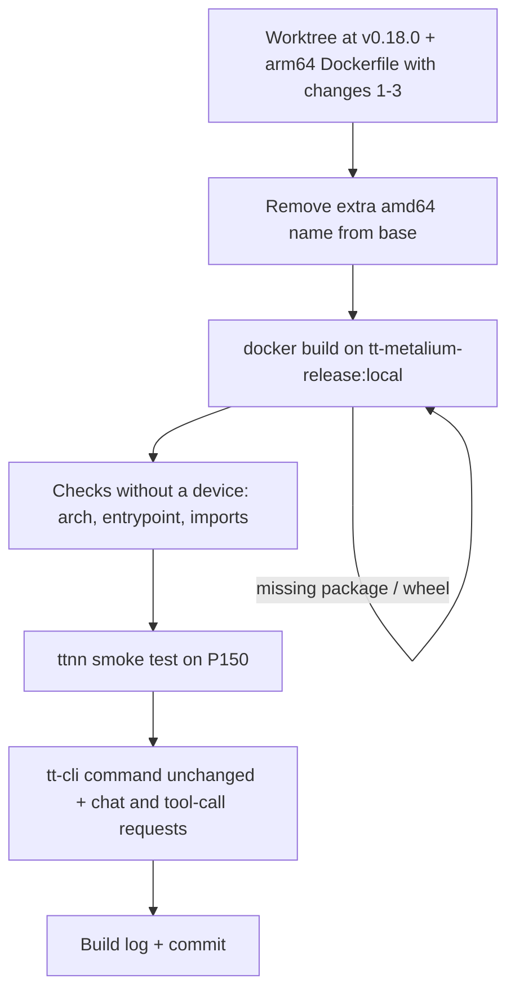

# Plan: ARM64 build of the vLLM tt-metal image (for tt-cli)

Goal: build an aarch64 version of the image tt-cli launches for LLMs, so this command works
unchanged on an ARM host with Blackhole cards:

```sh
docker run --rm --name tt-inference-server-d517878a \
  --env-file ~/.local/share/tenstorrent/tools/tt-inference-server-v0.18.0/src/.env \
  --ipc host --device /dev/tenstorrent:/dev/tenstorrent \
  --mount type=bind,src=/dev/hugepages-1G,dst=/dev/hugepages-1G \
  --publish 0.0.0.0:8000:8000 \
  --volume volume_id_tt_transformers-Llama-3.1-8B-Instruct:/home/container_app_user/cache_root \
  --mount type=bind,src=$HOME/.cache/huggingface/hub/models--meta-llama--Llama-3.1-8B-Instruct,dst=/home/container_app_user/readonly_weights_mount/Llama-3.1-8B-Instruct,readonly \
  -e MODEL_WEIGHTS_DIR=/home/container_app_user/readonly_weights_mount/Llama-3.1-8B-Instruct/snapshots/0e9e39f249a16976918f6564b8830bc894c89659 \
  ghcr.io/tenstorrent/tt-inference-server/vllm-tt-metal-src-release-ubuntu-22.04-amd64:0.18.0-c49bb76-6b4a3a7 \
  --model meta-llama/Llama-3.1-8B-Instruct --tt-device p150 --no-auth \
  --enable-auto-tool-choice --tool-call-parser llama3_json
```

This is a different image from the forge media server
(`tt-media-server-forge:arm64-tt`, see `tt-media-server/docs/arm64-forge-image-plan.md`). That
one serves image models through tt-xla, has no `ENTRYPOINT`, and can't parse these flags:
the arguments replace its `CMD`, giving `exec: "--model": executable file not found`.

## Findings

| | |
|---|---|
| Image tt-cli expects | `vllm-tt-metal-src-release-ubuntu-22.04-amd64:0.18.0-c49bb76-6b4a3a7` (for Llama-3.1-8B-Instruct in `release_model_spec.json`) |
| Pins | tt-metal `c49bb7625e` (2026-07-09), vLLM `6b4a3a7b4e` in **`tenstorrent/vllm`** (2026-07-02), tt-smi `v3.1.1` |
| Dockerfile | `vllm-tt-metal/vllm.tt-metal.src.dev.Dockerfile` **at tag `v0.18.0`** (`d5913e81`). It's byte-identical to tt-cli's copy under `~/.local/share/tenstorrent/tools/tt-inference-server-v0.18.0/src/` |
| Entrypoint | `run_vllm_api_server.py "$@"`, which parses `--model`, `--tt-device`, `--no-auth` and the tool-call flags |
| How it's built (`scripts/build_docker_images.py`) | 1. base image: tt-metal's `dockerfile/docker-bake.hcl` target `ci-build` at the tt-metal commit. 2. `docker build` of the vLLM Dockerfile with `TT_METAL_DOCKERFILE_URL=<base>`. 3. The release tag is just a re-tag of the dev image. |
| Local state | The "amd64" tag above is a second name for `tt-metalium-release:local` (same ID `bd99e0346dfe`, arm64). That's the bare tt-metal runtime (ttnn `d04395ed86`, 2026-08-29): no vLLM, no entrypoint, no `container_app_user`. tt-cli uses it because it exists locally, so the original command fails too. |

### Don't use HEAD's Dockerfile

- At HEAD, `vllm-tt-metal/vllm.tt-metal.src.dev.Dockerfile` clones `tenstorrent/vllm-tt-plugin`.
  That switch came in `3fdbc581`, after v0.18.0. `6b4a3a7` doesn't exist there; it's a
  `tenstorrent/vllm` commit.
- HEAD's `run_vllm_api_server.py` has changed by about 490 lines since v0.18.0.
- The v0.18.0 Dockerfile and entrypoint are what tt-cli v0.18.0's command was written for.

### Why `tt-metalium-release:local` can work as the base despite the commit mismatch

The builder stage clones tt-metal at `TT_METAL_COMMIT_SHA_OR_TAG` (`c49bb76`), builds it from
source into `~/tt-metal`, and the runtime stage copies it over. The base image's own tt-metal
(`/opt/venv` ttnn) is never used. The base only supplies the OS and system packages:

- `c49bb76` builds with clang-20 (`cmake/*-clang-20-libstdcpp-toolchain.cmake`). The base has
  clang-20, lld-20, libc++-20, gcc-12, CMake 4.2.3, ninja, hwloc/numa/tbb/capstone dev packages
  and ULFM OpenMPI.
- `c49bb76` pins SFPI 7.64.0, and its `sfpi-version` has aarch64 hashes. Without
  `--use-system-sfpi`, CMake downloads it, so the base's `/opt/tenstorrent/sfpi` (7.72.0)
  isn't used.
- The base is newer (by about 7 weeks) than `c49bb76`; the two are on different branches.
  Its system packages are probably a superset of what `c49bb76` needs. The build will confirm.

## Changes needed for aarch64

Starting from `git show v0.18.0:vllm-tt-metal/vllm.tt-metal.src.dev.Dockerfile`:

| # | Where | Problem | Change |
|---|---|---|---|
| 1 | builder, `bash ./build_metal.sh` | **Blocker.** It always defaults to `cmake/x86_64-linux-clang-20-libstdcpp-toolchain.cmake` (it doesn't switch on `uname -m`). That sets `CMAKE_SYSTEM_PROCESSOR=x86_64`, so tt-metal's `CMakeLists.txt` adds `-march=x86-64-v3`, which clang rejects on aarch64. | On aarch64, pass `--toolchain-path cmake/aarch64-linux-clang-20-libstdcpp-toolchain.cmake` (it exists at `c49bb76`) |
| 2 | builder, `create_venv.sh` | Run with `CXX=clang++-17 CC=clang-17`, which don't exist in the base | Use `clang++-20` / `clang-20` |
| 3 | builder and runtime `ENV` | The base sets `PATH=/opt/venv/bin:...` and `VIRTUAL_ENV=/opt/venv` (its own Python 3.10 ttnn venv). The tt-smi venv (`python3 -m venv`) would be created from it, and `uv` could see a stray `VIRTUAL_ENV`. | Reset `PATH` without `/opt/venv/bin` and set `VIRTUAL_ENV=` (as done in `tt-media-server/Dockerfile.forge.arm64`) |
| 4 | tags | The name `vllm-tt-metal-src-release-ubuntu-22.04-amd64:...` is taken by the local base image | Before building, remove that extra name from the base: `docker rmi <that tag>` (the image stays as `tt-metalium-release:local`). Then give the result that name so tt-cli can use it unchanged. |

Nothing else looks x86-specific. The runtime stage relinks the tt-metal venv's `python3` to
`/usr/bin/python3`; `create_venv.sh` picks Python 3.10 on Ubuntu 22.04, which matches the base's
`/usr/bin/python3` (3.10). vLLM is installed with `VLLM_TARGET_DEVICE=empty` (no CUDA or C++
kernels), and upstream vLLM publishes aarch64 builds.

## Steps

### 1. Source and Dockerfile

Create `vllm-tt-metal/vllm.tt-metal.src.dev.arm64.Dockerfile` from the v0.18.0 version with
changes 1 to 3. Add an `ARG BASE_IMAGE=tt-metalium-release:local` default for
`TT_METAL_DOCKERFILE_URL`, and a comment linking to this plan. Keep the diff small so it can be
rebased onto newer releases.

The build context has to be the **v0.18.0** tree, because the Dockerfile `COPY`s
`vllm-tt-metal/src`, `vllm-tt-metal/requirements.txt`, `utils`, `VERSION` and `model_spec.json`,
and HEAD's versions differ. Use a worktree so the working copy isn't touched:

```sh
git worktree add /tmp/ttis-v0.18.0 v0.18.0
cp vllm-tt-metal/vllm.tt-metal.src.dev.arm64.Dockerfile /tmp/ttis-v0.18.0/vllm-tt-metal/
# model_spec.json: use the same one tt-cli uses
cp ~/.local/share/tenstorrent/tools/tt-inference-server-v0.18.0/src/model_spec.json /tmp/ttis-v0.18.0/
```

(Check that `model_spec.json` at the v0.18.0 tag matches tt-cli's copy, or regenerate it with
`scripts/build_docker_images.py`'s `generate_model_specs_json()` at the tag.)

### 2. Build (native on aarch64, about 30 to 45 minutes; the tt-metal build takes most of it)

```sh
docker rmi ghcr.io/tenstorrent/tt-inference-server/vllm-tt-metal-src-release-ubuntu-22.04-amd64:0.18.0-c49bb76-6b4a3a7

cd /tmp/ttis-v0.18.0
docker build -f vllm-tt-metal/vllm.tt-metal.src.dev.arm64.Dockerfile \
  --build-arg TT_METAL_DOCKERFILE_URL=tt-metalium-release:local \
  --build-arg TT_METAL_COMMIT_SHA_OR_TAG=c49bb7625e \
  --build-arg TT_VLLM_COMMIT_SHA_OR_TAG=6b4a3a7b4e04c3b7f4f60dea97a7e156c3956d46 \
  --build-arg CONTAINER_APP_UID=1000 \
  -t vllm-tt-metal-src-dev-ubuntu-22.04-arm64:0.18.0-c49bb76-6b4a3a7 . 2>&1 | tee /tmp/vllm-arm64-build.log

# the name tt-cli looks for (release = re-tagged dev, as in build_docker_images.py)
docker tag vllm-tt-metal-src-dev-ubuntu-22.04-arm64:0.18.0-c49bb76-6b4a3a7 \
  ghcr.io/tenstorrent/tt-inference-server/vllm-tt-metal-src-release-ubuntu-22.04-amd64:0.18.0-c49bb76-6b4a3a7
```

`CONTAINER_APP_UID`: `build_docker_images.py` passes one explicitly. Check which UID tt-cli
expects for the `cache_root` volume, and match it.

### 3. Check without a device

```sh
IMG=vllm-tt-metal-src-dev-ubuntu-22.04-arm64:0.18.0-c49bb76-6b4a3a7
docker image inspect $IMG --format '{{.Architecture}} {{json .Config.Entrypoint}}'   # arm64, run_vllm_api_server.py
docker run --rm $IMG --help | head                                                   # entrypoint parses args
docker run --rm --entrypoint bash $IMG -c 'source $PYTHON_ENV_DIR/bin/activate &&
  python -c "import ttnn, vllm; print(vllm.__version__)" && file $TT_METAL_HOME/build/lib/libtt_metal.so'
```

### 4. On device

1. `ttnn` smoke test: open a device and run a small op on a P150.
2. The tt-cli command above, unchanged. Wait for the server to be ready, then:
   ```sh
   curl -s localhost:8000/v1/models
   curl -s localhost:8000/v1/chat/completions -H 'Content-Type: application/json' \
     -d '{"model":"meta-llama/Llama-3.1-8B-Instruct","messages":[{"role":"user","content":"What is the capital of France?"}],"max_tokens":32}'
   ```
3. A tool-call request (`--enable-auto-tool-choice --tool-call-parser llama3_json`).
4. Optional: tt-inference-server's own benchmark/eval workflow for this model, to compare
   throughput and accuracy with the x86 image.

### 5. Document

Record every command, timing and result in `docs/arm64-vllm-tt-metal-build-log.md`, in the
same format as `tt-media-server/docs/arm64-forge-build-log.md`. Commit the arm64 Dockerfile
and the docs.

## Risks and open questions

- **System packages.** The base is the `release` image built from tt-metal `d04395ed86`,
  not the `ci-build` target at `c49bb76` that upstream uses. If `c49bb76` needs a build package
  the base doesn't have, add it with `apt-get` in the builder stage. The build will show it.
- **Python packages on aarch64.** `create_venv.sh` and
  `models/demos/qwen25_vl/requirements.txt` at `c49bb76`, and vLLM `6b4a3a7`'s requirements,
  may pin something without an aarch64 build. The fix is either a different version or a
  source build.
- **tt-transformers on ARM.** Llama-3.1-8B on P150 through tt-metal's model code hasn't been run
  on aarch64. The forge work showed tt-metal itself runs fine on this host's Blackhole cards.
- **Motherboard warnings.** tt-metal logs "Unknown motherboard `MP32-AR0-JG`" and falls back to
  bus IDs. That was harmless for single-card forge runs; confirm it's also fine for LLM runs,
  including anything multi-card.
- **Reusing the amd64 name.** tt-cli keeps working unchanged, but an arm64 image carries an
  `amd64` name. If tt-cli ever re-pulls, it may replace it; on arm64 the pull fails or yields
  the x86 image. Longer term: an `-arm64` tag and a tt-cli option to choose the image, or a
  multi-arch manifest.
- **Newer releases.** Later releases switch to `vllm-tt-plugin` + upstream vLLM (HEAD's
  Dockerfile); changes 1 to 3 would apply there too. Ideally changes 1 and 2 go upstream
  (`build_metal.sh` choosing the toolchain from `uname -m`, and no hardcoded clang-17).

## Order


